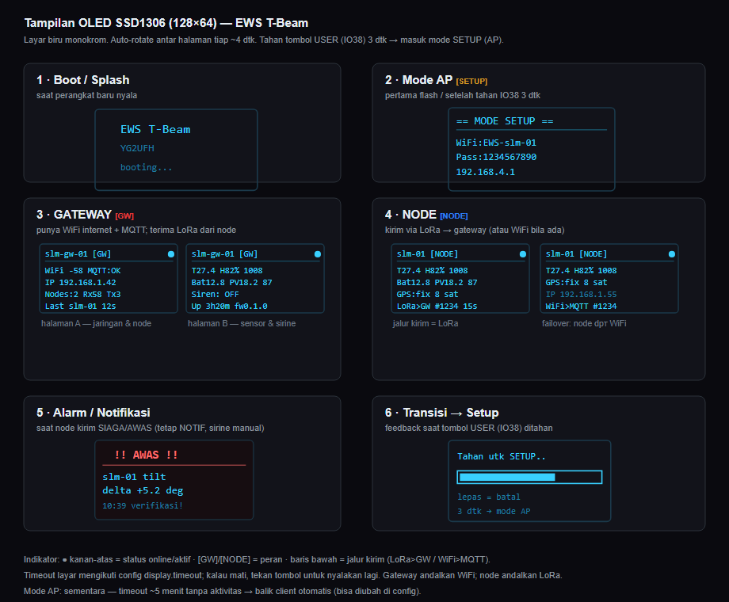

# Panduan Perangkat EWS T-Beam (YG2UFH)

Panduan pemakaian perangkat Early Warning System (EWS) berbasis LilyGO T-Beam
v1.2 — dari flashing firmware, setup pertama, membaca layar OLED, sampai
troubleshooting. Ditujukan untuk operator/relawan lapangan.

> Catatan: dokumen ini panduan PEMAKAIAN. Untuk detail teknis firmware (skema
> MQTT, format paket LoRa, pin map) lihat [`../firmware/README.md`](../firmware/README.md).
> Untuk arsitektur sistem lihat [`technical-design.md`](technical-design.md).

---

## 1. Konsep singkat: GATEWAY vs NODE

Satu firmware, dua peran. Peran dipilih lewat web config (bukan jumper).

| | **GATEWAY** | **NODE** |
|---|---|---|
| Tugas | Kumpulkan data, teruskan ke internet | Baca sensor di lapangan |
| Internet | ✅ konek WiFi → kirim ke server MQTT | biasanya ❌ (opsional bila ada WiFi) |
| LoRa | terima data dari node | kirim data ke gateway |
| Sirine | umumnya di gateway | opsional |

Alur data: **NODE** baca sensor → kirim via **LoRa** → **GATEWAY** → teruskan via
**WiFi/MQTT** → server EWS → dashboard. Kalau sebuah node kebetulan punya WiFi,
dia bisa kirim langsung ke MQTT (failover).

---

## 2. Flash firmware (sekali di awal)

### Cara mudah: Web Flasher (tanpa install apa pun)

Buka halaman flasher di **Chrome/Edge** (komputer, bukan HP):

👉 **https://venougm.github.io/ews_yg2ufh/webflasher/**

1. Colok T-Beam ke komputer pakai **kabel USB data**.
2. Klik **⚡ Install Firmware EWS**.
3. Pilih port serial T-Beam (biasanya muncul sebagai "CP210x" / "CH9102").
4. Tunggu sampai selesai — jangan cabut USB. Perangkat reboot otomatis.

> Kalau port tidak muncul: install driver USB-serial (CP210x atau CH9102/CH340
> tergantung chip USB board), lalu colok ulang.

### Cara developer: PlatformIO

```sh
python -m platformio run -e ttgo-t-beam-ews -t upload     # firmware
python -m platformio run -e ttgo-t-beam-ews -t uploadfs   # aset web (WAJIB sekali)
```

---

## 3. Setup pertama (mode AP)

Setelah di-flash, perangkat jadi **Access Point** WiFi.

1. Di HP/laptop, sambung ke WiFi:
   - SSID: **`EWS-<node_id>`** (atau `YG2UFH-EWS-Setup` kalau node_id belum diisi)
   - Sandi: **`1234567890`**
2. Buka browser → **`http://192.168.4.1`**
3. Isi form **Setup Perangkat EWS**:
   - **Peran**: Node atau Gateway
   - **Identitas & Lokasi**: node_id + wilayah (Provinsi → Kabupaten → Kecamatan →
     Kelurahan, semua **dropdown** anti-typo) + koordinat (isi manual)
   - **WiFi**: SSID + sandi jaringan internet (wajib untuk gateway)
   - **MQTT**: host server, port, user (untuk gateway)
   - **LoRa**: frekuensi 915 + preset (jauh/cepat) — harus sama di semua perangkat
     satu jaringan
   - **Sensor**: centang yang terpasang
   - **Sirine**: aktifkan bila ada relay sirine
4. Tekan **Simpan & Jalankan** → perangkat reboot jadi **WiFi client** dan mulai
   bekerja.

Pratinjau tampilan form (mockup): [`mockup/device-setup.html`](mockup/device-setup.html)
dan halaman status [`mockup/device-status.html`](mockup/device-status.html).

> **Wilayah pakai dropdown bertingkat** supaya tidak salah ketik — penting karena
> nama kabupaten dipakai di alamat MQTT. Pilih provinsi → pilihan kabupaten
> terisi, dan seterusnya sampai kelurahan.

---

## 4. Mengubah config setelah jadi client (tombol IO38)

Begitu jadi client, perangkat tidak lagi memancarkan WiFi AP. Untuk mengubah
setting lagi:

**Tahan tombol USER (IO38) di T-Beam selama ~3 detik.**

- T-Beam v1.2 punya 3 tombol fisik: **Reset**, **Power**, dan **IO38 (USER)**.
  Yang dipakai untuk masuk setup adalah **IO38** (tombol user, bukan Reset/Power).
- Saat ditahan, OLED menampilkan progress bar "Tahan utk SETUP..". Lepas sebelum
  3 detik = batal.
- Setelah 3 detik → perangkat masuk **mode AP** lagi (`EWS-<node_id>` /
  `192.168.4.1`). Edit config seperti langkah 3, lalu Simpan & Jalankan.
- Mode AP ini **sementara**: kalau tidak ada yang connect ~5 menit, perangkat
  balik jadi client otomatis (ambang bisa diubah di config).

---

## 5. Membaca layar OLED

Layar OLED 128×64 (biru) menampilkan status perangkat dan berganti halaman
otomatis tiap ~4 detik. Kalau layar mati (hemat daya), tekan tombol untuk
menyalakannya.



| Layar | Kapan muncul | Isi |
|-------|--------------|-----|
| **1 Boot** | baru nyala | splash "EWS T-Beam / YG2UFH" |
| **2 Mode AP** | pertama flash / setelah tahan IO38 | SSID, sandi, `192.168.4.1` untuk setup |
| **3 Gateway** | peran GW, jalan normal | A: WiFi RSSI, MQTT, **IP lokal**, jumlah node, Rx/Tx · B: sensor, daya, sirine, uptime |
| **4 Node** | peran NODE, jalan normal | A: sensor, daya, **GPS fix+satelit**, `LoRa>GW #seq` + hitung mundur kirim · B (failover): IP + `WiFi>MQTT` bila node dapat WiFi |
| **5 Alarm** | node kirim SIAGA/AWAS | layar peringatan (tetap NOTIFIKASI; sirine TIDAK otomatis) |
| **6 Transisi Setup** | tombol IO38 ditahan | progress bar menuju mode AP |

Indikator:
- **Bulatan kanan-atas** = status online/aktif.
- **`[GW]` / `[NODE]`** = peran perangkat.
- **Baris paling bawah** = jalur kirim data: `LoRa>GW` (node via LoRa) atau
  `WiFi>MQTT` (gateway, atau node yang dapat WiFi).

---

## 6. Status normal yang sehat

**Gateway sehat:**
- OLED halaman A: `WiFi` ada nilai dBm, `MQTT:OK`, `IP` terisi, `Nodes:` ≥ 1.
- Dashboard EWS menampilkan node hijau/online.

**Node sehat:**
- OLED: sensor terisi, `GPS:fix` (kalau GPS aktif), baris bawah `LoRa>GW` dengan
  nomor `#seq` yang NAIK tiap interval.
- Di gateway, node ini muncul di daftar "Node Terdengar".

---

## 7. Troubleshooting

| Gejala | Kemungkinan | Solusi |
|--------|-------------|--------|
| OLED kosong/mati | display timeout / disabled | tekan tombol; cek `display.enabled` di config |
| Web flasher tidak lihat port | driver USB belum ada / kabel charge-only | install driver CP210x/CH9102; ganti kabel data |
| `192.168.4.1` tidak kebuka | belum tersambung ke AP perangkat | cek WiFi HP tersambung ke `EWS-...` / `YG2UFH-EWS-Setup` |
| Gateway `MQTT` tidak OK | host/port/user salah, atau internet mati | cek setting MQTT; cek WiFi internet |
| Node tidak muncul di gateway | LoRa beda parameter | pastikan frekuensi/SF/BW/CR SAMA di node & gateway |
| Data tidak masuk dashboard | kabupaten slug beda / backend | pakai dropdown wilayah (jangan ketik manual); cek backend jalan |
| Tidak bisa masuk setting lagi | sudah mode client | tahan tombol **IO38** 3 detik → mode AP |
| GPS tidak fix | indoor / antena | bawa ke area terbuka; tunggu beberapa menit |

---

## 8. Catatan penting

- **Sirine MANUAL.** Perangkat TIDAK pernah membunyikan sirine otomatis dari
  sensor. Sirine hanya bunyi dari perintah operator (via dashboard/MQTT). Alarm
  SIAGA/AWAS di OLED/dashboard hanya NOTIFIKASI untuk diverifikasi manusia.
- **Koordinat diisi manual** saat setup (bukan dari GPS), jadi posisi di
  dashboard konsisten.
- **Parameter LoRa harus seragam** se-jaringan, kalau tidak node & gateway tak
  saling dengar.
- **HTTPS untuk produksi.** Web flasher sudah HTTPS (GitHub Pages). Backend
  dashboard harus di belakang HTTPS sebelum dipakai publik.
